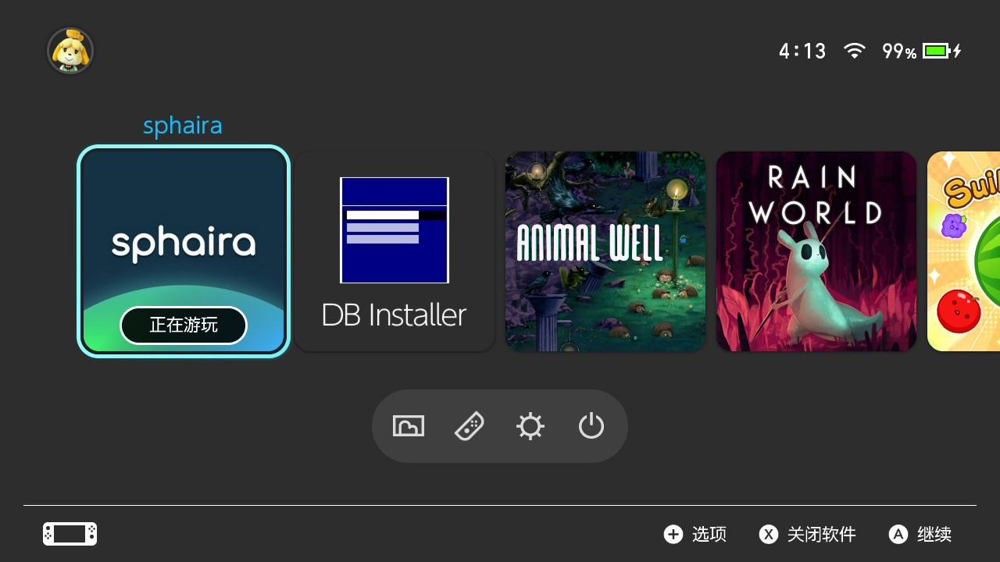
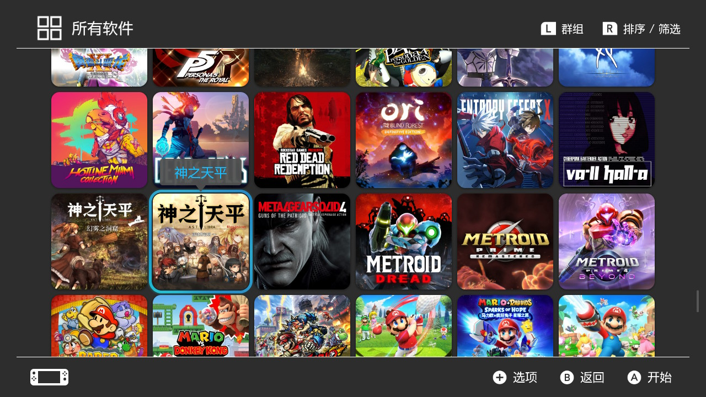
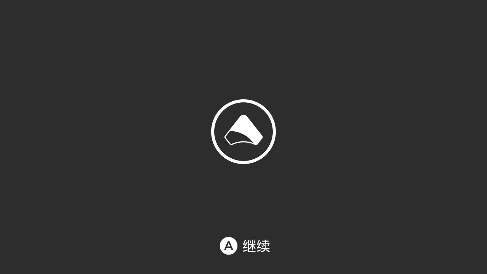

Minimal Two (for HOS 23.0.1, Atmosphere 1.12.1+)

| 主页 | 所有软件 | 锁屏 |
| :---: | :---: | :---: |
|  |  |  |

# 说明

此为适用于 Nitendo Switch 1 的主题，移除了无用按钮，适度增加圆角，旨在提供简洁的大气层体验。

已于版本 HOS 23.0.1 测试，不兼容旧版本系统，且未测试新系统。

# 安装方法

请使用最新的 NXThemes Installer(3.0.2或者更新) 安装此主题。请使用最新的大气层固件(1.12.1或者更新)。旧版固件会导致主题无法生效。

将 themes 文件夹拖放到SD卡根目录里，若提示覆盖则进行覆盖。此文件夹内包含主题所需的三个文件和必要的SystemPatch。

拖放完毕后，打开 NXThemes Installer，分别安装三个 *.nxtheme文件，重启即可。

# 致谢

主题部分参考自

https://themezer.net/switch/layouts/banned-layout-19DA0

https://themezer.net/switch/layouts/banned-19DCC
